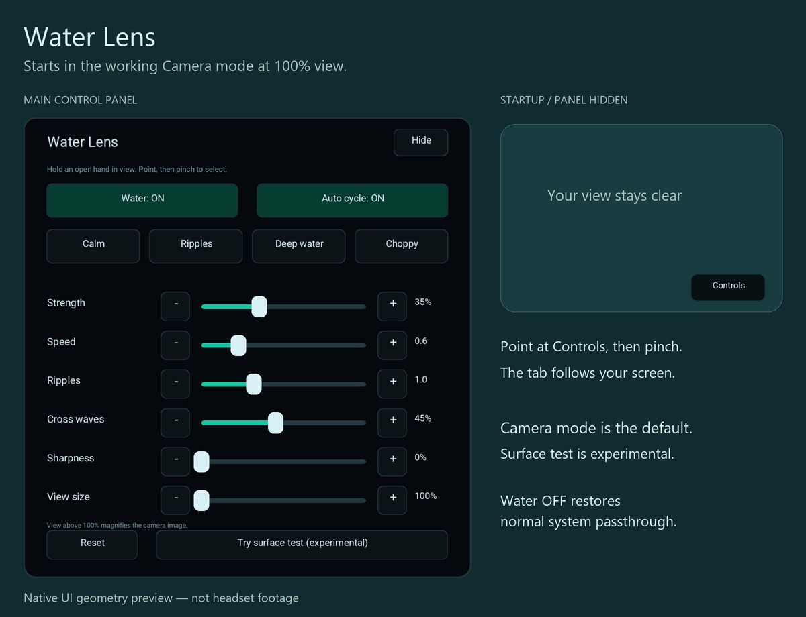

# Water Lens for Meta Quest 3

Native stereo passthrough with an animated water distortion, hand-controlled buttons and sliders, and unattended USB diagnostics. This is a development prototype, not a store release.

**The working effect uses the two headset cameras and has a visible coverage boundary at 100% scale. Full-view distortion without zoom has not been achieved.** The experimental surface-projected mode accepts mesh updates, but has not produced useful water distortion on the tested Quest 3.



## Install on a Quest 3

1. Download `water-lens-stereo.apk` from [Releases](https://github.com/maxlobovsky/water-lens-quest/releases/latest).
2. Enable Developer Mode for your headset, connect USB, and allow USB debugging.
3. Install Android [platform-tools](https://developer.android.com/tools/releases/platform-tools), then run:

   ```powershell
   adb install -r water-lens-stereo.apk
   ```

4. Open **Library → Unknown Sources → Water Lens Stereo**. Allow camera, headset-camera, hand-tracking and scene permissions when requested.

The app starts in Camera mode at 100% view. Point at the small lower-right **Controls** tab and pinch to open the panel. Presets and sliders adjust strength, speed, ripple density, cross waves, sharpness and view size. **Water OFF** returns to normal passthrough. View size above 100% magnifies the available camera picture; it does not capture a wider view.

The **Surface test** button is an experiment with no proven water effect. Use **Back to Camera** to restore the working effect.

## Unattended testing over USB

Leave the headset plugged in, stationary, with its outward cameras unobstructed and facing a lit room. No controller or wearer is needed for the tested capture workflow.

Install Meta's official CLI with `npm install -g metavr` and Android platform-tools, then:

```powershell
cd water-lens-native
.\test-unattended.ps1 -Mode Camera
.\test-unattended.ps1 -Mode SurfaceProbe
.\test-unattended.ps1 -Mode Camera -Strength 1 -Speed 8 -Sharpness 1
```

The script chooses the connected Quest, preferring USB; use `-Device <adb-id>` if multiple headsets are connected. It temporarily overrides proximity and pauses the boundary **for stationary bench testing**, checks real app/tracking/frame telemetry, records stereo output, retrieves screenshots/logs, stops the test app, and restores the original boundary/proximity settings. Do not wear or walk with the headset during this test.

Results are reused under `water-lens-native/build/unattended-<mode>.*` (`.json`, `.mp4`, `.png`, `.log`). Runtime PASS means the requested renderer stayed active; it does not certify the visual effect or stereo comfort. The test uses a one-launch local configuration file, not a network server. If a host process is interrupted, its saved device state is recovered on the next run; proximity also has a time limit.

`Camera`, `Normal`, `Surface`, and `SurfaceProbe` are supported. Controls can be set with `-Strength`, `-Speed`, `-Ripples`, `-CrossWaves`, `-Sharpness`, and `-ViewSize`. `SurfaceProbe` colors the projected layer green and changes its footprint to test mesh visibility.

## Build from source on Windows

No Unity or Gradle project is required. PowerShell, a C++ Android NDK toolchain, Java 17, Android build tools and the OpenXR Android loader are used.

```powershell
cd water-lens-native
.\setup-toolchain.ps1
.\build.ps1
.\test-controls.ps1 -Preview
```

The bootstrap downloads pinned dependencies with SHA-256 verification into the shared `%LOCALAPPDATA%\Android\water-lens-toolchain` folder and reuses existing installations. It needs several GB of disk space. `build.ps1` creates a local development signing key there; the key is never uploaded. An APK built with your own key cannot replace an APK signed by someone else without uninstalling the previous package first.

The generated UI glyph atlas is included. To regenerate it and the static preview, install Pillow in your shared Python environment, then run `python make-ui-font.py` and `python make-preview.py`. Roboto font data is downloaded from a pinned source into the shared toolchain cache; its OFL license is included.

## Project contents

- `water-lens-native/`: current native OpenXR/GLES app, stereo Camera2 import, depth-aware reprojection, hand UI, surface experiment, build and capture scripts.
- `water-lens/`: original browser/WebGL prototype and logic tests. It is preserved for reference; headset-camera access in Quest Browser was not a reliable route for this app.
- [Experiment notes](water-lens-native/README.txt): implementation details and measured camera/surface results.
- `water-lens-native/assets/`: UI atlas and third-party license notices.

Browser logic checks run with `node water-lens/tests/rendering.cjs`. Native control/mesh tests run directly on the connected Quest with `test-controls.ps1`. `connect-quest.ps1` enables Wi-Fi ADB over an authorized USB connection or discovers a previously enabled headset through mDNS.

## Findings and limitations

- 1728×1728 camera streams increase resolution but showed essentially the same field of view as 1280×1280 on the tested headset.
- The renderer requests the highest supported refresh rate (120 Hz on the test device). Camera frames arrive separately, typically around 45–60 stereo pairs/sec in the captured sessions. These rates are not measured motion-to-photon latency.
- Native surface-projected passthrough is visible in both eyes and accepts mutable mesh updates. A green-window diagnostic visibly changed its footprint, but changing surface depth has not delivered the desired water refraction.
- Unattended capture can verify rendering, calibration paths and controls programmatically. Stereo comfort and behavior during real head/hand movement still need wearer testing.

Personal room/screen recordings, raw camera captures, signing keys, SDK downloads and local build outputs are excluded from this repository. No account credentials are required by the app. Camera images are processed on-device; ordinary launches do not record or upload them.

Third-party components retain their included licenses.
